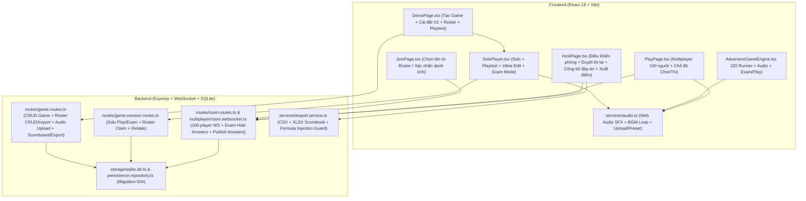

# KẾ HOẠCH TRIỂN KHAI KIẾN TRÚC AI GAME PLATFORM V2

**Tài liệu:** Báo cáo Audit Kiến Trúc & Kế Hoạch Triển Khai V2 (Phase 0)  
**Project Root:** `E:\Lập trình\MatBaoWS\game`  
**Chế độ thực thi:** `SOURCE-FIRST · PHASED DELIVERY · MINIMAL-DIFF · REGRESSION-SAFE`  
**Trạng thái:** Hoàn tất Phase 0 (Audit & Lập kế hoạch) — Chờ phê duyệt trước khi triển khai Phase 1.

---

## 1. KIẾN TRÚC HIỆN TẠI & TRẢ LỜI 10 CÂU HỎI AUDIT BẮT BUỘC

### 1.1. Tổng quan kiến trúc hệ thống hiện tại
- **Backend (`src/`)**: Node.js + Express + TypeScript (`ES2022`), cơ sở dữ liệu SQLite (`node:sqlite` `DatabaseSync` chạy chế độ `WAL`, quản lý migration qua bảng `_migrations` tại `src/storage/sqlite.db.ts`), thời gian thực qua WebSocket (`ws` tại `/ws` trong `src/multiplayer/room.websocket.ts`).
- **Frontend (`frontend/src/`)**: React 18 + Vite + TypeScript, quản lý điều hướng SPA qua URL query (`?tab=...`, `?play=...`, `?room=...`) tại `frontend/src/App.tsx`.
- **Thư viện sẵn có trong `package.json`**: Đã cài sẵn `xlsx` (`^0.18.5`), `multer` (`^2.4.0`), `zod` (`^4.6.5`), `ws` (`^8.22.0`), `qrcode` (`^1.5.4`). **Không cần cài thêm bất kỳ dependency bên ngoài nào** cho việc import danh sách người tham gia (`.csv`/`.xlsx`), upload nhạc nền hay xuất bảng điểm Excel (`.xlsx`).

---

### 1.2. Trả lời chi tiết 10 câu hỏi Audit nguồn (kèm tham chiếu file & dòng)

#### Câu 1: Component nào đang hiển thị câu hỏi?
Hệ thống hiện có **4 khu vực hiển thị câu hỏi** tùy theo chế độ chơi:
1. **Solo & Playtest truyền thống (`MCQ`, `TRUE_FALSE`, `SHORT_ANSWER`, `CROSSWORD`, `PUZZLE`, `SLIDER`, `MIXED`)**:
   - File: `frontend/src/components/SoloPlayer.tsx` (dòng `1–1250`).
   - Nhận prop `playtestMode?: boolean` (`true` khi chạy Chơi thử trong bộ nhớ tại `DemoPage.tsx`; `false` khi chơi Solo thật qua API `/api/games/sessions`).
2. **Game Phiêu lưu 2D (`ADVENTURE`) cho cả Solo, Playtest và Preview**:
   - File: `frontend/src/components/AdventureGameEngine.tsx` (dòng `1–1030`).
   - Hiển thị canvas 2D Runner và modal câu hỏi chướng ngại vật (`runner-checkpoint-modal`, dòng `815–990`).
3. **Multiplayer — Màn hình Máy chiếu của Host**:
   - File: `frontend/src/pages/HostPage.tsx` (`viewState === 'question'`, dòng `750–960`).
4. **Multiplayer — Màn hình Thiết bị Người chơi**:
   - File: `frontend/src/pages/PlayPage.tsx` (`screen === 'question'`, dòng `640–1250`).
5. *(Phụ trợ)* **Màn hình Trình chiếu QR Chơi đơn**:
   - File: `frontend/src/pages/SoloPresentationPage.tsx` (dòng `1–418`) — chỉ hiển thị mã QR và liên kết dẫn vào `SoloPlayer`, bản thân trang này không trực tiếp render câu hỏi.

#### Câu 2: Component nào đang hiển thị feedback sau mỗi câu hỏi?
1. **Solo & Playtest (`frontend/src/components/SoloPlayer.tsx`, dòng `960–1160`)**:
   - Biến state `questionFeedback` (`QuestionResult | null`) hiển thị banner `Chính xác! +X điểm` hoặc `Chưa chính xác (0 điểm)`, kèm `Đáp án đúng: ...` và `Giải thích: ...`.
   - **Khoảng trống hiện tại so với yêu cầu V2**:
     - Hiện tại sau khi trả lời, người chơi phải bấm thủ công nút `Tiếp Tục →` / `Xem Kết Quả` (`handleNextQuestion`), **chưa tự động chuyển sang câu tiếp theo sau 3–5 giây**.
     - Khi hết giờ câu hỏi ở chế độ Solo thật (`SoloPlayer.tsx` dòng `255–265`), hàm `handleNextQuestion()` được gọi ngay lập tức khiến câu hỏi bị bỏ qua mà **không hiển thị trạng thái "Hết giờ! Bạn chưa chọn đáp án" (0 điểm)** trong 3–5 giây trước khi qua câu mới.
2. **Adventure 2D (`frontend/src/components/AdventureGameEngine.tsx`, dòng `925–985`)**:
   - Hiển thị `checkpoint-feedback-panel` bên trong `runner-checkpoint-modal` và chờ người chơi bấm `checkpoint-continue-btn` (`Tiếp tục hành trình`).
3. **Multiplayer Host & Player (`HostPage.tsx` dòng `965–1070`, `PlayPage.tsx` dòng `1255–1450`, `src/multiplayer/room.websocket.ts` dòng `28–75`)**:
   - Sự kiện `question.revealed` gửi `correctAnswer`, `explanation`, `leaderboard`, `personalResult` và tự động chuyển câu sau `MULTIPLAYER_CONFIG.AUTO_ADVANCE_DELAY_MS = 4000` (4 giây).
   - **Khoảng trống ở chế độ THI (`EXAM`)**: Hiện tại cả Solo (`POST /api/games/sessions/:sessionId/answer`) lẫn Multiplayer (`question.revealed`) đều trả về ngay `correctAnswer` và `explanation`. Ở chế độ **THI**, Backend phải ẩn tuyệt đối `correctAnswer` và `explanation` trong suốt quá trình làm bài cho tới khi kết thúc bài thi và BTC bấm **Công bố đáp án**.

#### Câu 3: Bộ đếm giờ (Timer) đang nằm ở Frontend hay Backend?
- **Solo Mode**:
  - **Backend (`src/game/game.timer.ts` & `src/game/game.session.ts` dòng `75–185`)**: Sử dụng class `GameTimer` lưu `startedAtMs` và `limitMs = timePerQuestion * 1000` (hoặc `+ 600_000ms` cho `ADVENTURE`). Khi `submitAnswer()` hoặc `getCurrentClientQuestion()` được gọi, Backend kiểm tra `timer.isExpired(nowMs)`.
  - **Frontend (`SoloPlayer.tsx` dòng `238–275`)**: Dùng `setInterval(..., 1000)` đếm ngược `remainingTime` từ `currentQ.remainingTimeSeconds` để hiển thị UI.
  - **Khoảng trống V2**:
    1. Chưa có trường thời gian riêng cho từng câu hỏi (`question.timeLimitSeconds`) ghi đè lên `settings.timePerQuestion`.
    2. Chưa có cấu hình đồng hồ tổng thời gian toàn bài (`examDurationMinutes` / `totalDurationSeconds`) hoặc không giới hạn thời gian.
    3. Khi tab trình duyệt bị ẩn/mất focus, `setInterval` trên Frontend có thể bị trình duyệt throttle — cần đồng bộ theo mốc `deadlineAtMs` từ Server (`Date.now()` lệch chuẩn với server timestamp).
- **Multiplayer Mode**:
  - **Backend (`src/multiplayer/room.service.ts` dòng `232–255` & `room.websocket.ts` dòng `94–112`)**: **Server-authoritative hoàn toàn**. Server đặt `questionStartedAt`, `questionDeadlineAt = now + timePerQuestion * 1000` và `room.timerHandle = setTimeout(...)`. Khi hết giờ, Server tự gọi `revealQuestion()` và sau `4000ms` tự gọi `advanceRoomOrFinish()`.
  - **Frontend (`HostPage.tsx` dòng `172–178`, `PlayPage.tsx` dòng `255–265`)**: Tính `Math.ceil((msg.question.deadlineAt - Date.now()) / 1000)` để hiển thị đồng hồ đếm ngược.

#### Câu 4: Điểm tối đa (`maxPossibleScore`) đang tính như thế nào?
- Tại **Backend (`src/game/game.scoring.ts`, dòng `103–129`, hàm `calculateMaxPossibleScore`)**:
  - `STANDARD`: $\text{maxPossibleScore} = N \times 100$ (100 điểm cố định mỗi câu đúng).
  - `SPEED_BONUS`: $\text{maxPossibleScore} = N \times 150$ (100 điểm gốc + tối đa 50 điểm thưởng tốc độ khi trả lời tức thì).
  - `STREAK`: $\text{maxPossibleScore} = \sum_{i=1}^{N} \left(100 + \min((i - 1) \times 20, 100)\right)$ (câu 1: 100đ, câu 2: 120đ, câu 3: 140đ, câu 4: 160đ, câu 5: 180đ, từ câu 6 trở đi: 200đ/câu).
- **Lỗi lệch công thức phát hiện được khi Audit**:
  1. Trong `SoloPlayer.tsx` (dòng `192`, chế độ `playtestMode`): Đang tính nhẩm `totalQ * (gameSpec.settings.scoringMode === 'SPEED_BONUS' ? 150 : 100)` — **bị sai khi `scoringMode === 'STREAK'`** (ví dụ 5 câu Streak đạt tối đa 700đ nhưng Playtest tính max là 500đ dẫn tới hiển thị `700 / 500` hoặc `140%`).
  2. Trong `AdventureGameEngine.tsx` (dòng `128`): Cộng cố định `+100` điểm mỗi câu đúng và màn hình kết thúc chỉ hiển thị tổng điểm mà chưa hiển thị `Điểm đạt được / Tổng điểm tối đa`, `Số câu đúng / Tổng số câu`, `Tỷ lệ % chính xác` và nhận xét theo 4 ngưỡng chuẩn.
  3. Trong `PlayPage.tsx` và `HostPage.tsx` (Multiplayer): Màn hình kết thúc mới chỉ hiển thị tổng điểm (`score`) và số câu đúng (`correctCount`), chưa hiển thị `maxPossibleScore`, `% chính xác` và nhận xét theo khung đánh giá 4 mức (`<50%`, `50–69%`, `70–89%`, `90–100%`).

#### Câu 5: Phòng Multiplayer tạo và kết thúc như thế nào?
- **Tạo phòng (`POST /api/rooms` tại `src/routes/room.routes.ts` dòng `42–92`)**:
  - Nhận `{ gameId }` từ người tạo (hoặc khách với game công khai), gọi `roomManager.createRoom(spec, req.authUser?.userId ?? null)`.
  - Sinh `roomId` (`room_...`), `roomCode` (6 ký tự chữ-số in hoa không trùng), `hostToken` (48 ký tự hex bí mật), lưu vào bộ nhớ `RoomManager.rooms` (`src/multiplayer/room.service.ts` dòng `460–510`).
  - Giới hạn hiện tại trong `src/multiplayer/room.types.ts`: `MAX_PLAYERS_PER_ROOM: 50`, `MAX_ROOMS_ACTIVE: 100`. **(Cần nâng `MAX_PLAYERS_PER_ROOM` lên `100` ở Phase 4 để đáp ứng yêu cầu 100 người chơi/thi cùng lúc).**
- **Kết thúc tự nhiên (`endGame` tại `src/multiplayer/room.service.ts` dòng `366–395`)**:
  - Khi hết câu hỏi cuối cùng, `nextQuestion()` chuyển trạng thái phòng sang `RoomStateEnum.FINISHED`, lưu lịch sử phòng vào bảng `room_history` qua `persistenceRepo.saveRoomHistory(...)` và phát sự kiện WebSocket `game.finished` kèm `leaderboard` và `winner`.
- **Đóng phòng chủ động bởi Host (`POST /api/rooms/:roomCode/close` tại `src/routes/room.routes.ts` dòng `141–195`)**:
  - Xác thực `hostToken` (qua Header `X-Host-Token` hoặc JSON Body `hostToken`) hoặc quyền chủ sở hữu game / Admin.
  - Gọi `roomManager.closeRoom(roomCode)` → `room.close()` xóa timer, lưu `room_history` (trạng thái `FINISHED` nếu đã kết thúc câu hỏi hoặc `ABANDONED` nếu đóng giữa chừng), đóng kết nối WebSocket với mã `4000`.

#### Câu 6: Kết quả người chơi đang lưu như thế nào?
1. **Solo Mode (`practice_sessions` trong SQLite — `src/storage/persistence.repository.ts` dòng `713–791`)**:
   - Lưu từng phiên vào bảng `practice_sessions` gồm: `session_id`, `game_id`, `owner_user_id`, `game_title`, `game_type`, `scoring_mode`, `state` (`CREATED` / `IN_PROGRESS` / `FINISHED` / `ABANDONED`), `total_questions`, `answered_questions`, `correct_answers`, `wrong_answers`, `total_score`, `max_possible_score`, `max_streak`, `duration_ms`, `results_json` (mảng chi tiết từng câu trả lời `QuestionResult[]`), `started_at`, `finished_at`.
   - **Khoảng trống V2**: Chưa có cột thông tin định danh người tham gia từ danh sách BTC (`participant_id`, `participant_name`, `department_unit`, `attempt_number`, `session_mode` = `PLAY` | `EXAM`, `is_passed`).
2. **Multiplayer Mode (`room_history` trong SQLite — `src/storage/persistence.repository.ts` dòng `896–969`)**:
   - Lưu 1 bản ghi tổng hợp cho mỗi phòng vào bảng `room_history` gồm `room_id`, `room_code`, `game_id`, `owner_user_id`, `state`, `player_count`, `total_questions`, `leaderboard_json` (mảng `LeaderboardEntry[]` gồm `rank`, `playerId`, `displayName`, `score`, `correctCount`, `streak`, `totalResponseTimeMs`).
   - **Khoảng trống V2**: Chưa lưu chi tiết từng lượt làm bài của từng thí sinh theo danh sách cấu hình sẵn (`participant_id`, `department_unit`, `attempt_number`, `max_possible_score`, `accuracy_percent`, `started_at`, `finished_at`, `status`).

#### Câu 7: Đã có cơ chế danh sách người tham gia cấu hình sẵn (Pre-configured Roster) chưa?
- **Chưa có.**
- Hiện tại:
  - Ở **Solo Mode**: Người chơi bấm vào chơi ngay (lấy `req.authUser?.userId` nếu đã đăng nhập hoặc `null` nếu là khách ẩn danh), không có bước chọn tên hay xác nhận thông tin định danh.
  - Ở **Multiplayer Mode (`JoinPage.tsx` dòng `173–194`)**: Người chơi tự gõ chuỗi `displayName` tự do vào ô input, chưa có tuỳ chọn chọn tên từ danh sách BTC cấu hình sẵn, chưa có bước xác nhận `"Bạn có chắc chắn là [Họ và tên] - [Phòng ban/Đơn vị] không?"`, và chưa có cơ chế khóa slot chống chọn trùng người hoặc quản lý lượt thi lại (Retake).

#### Câu 8: Database hiện tại hỗ trợ những gì?
- File `src/storage/sqlite.db.ts` (dòng `75–285`) hiện có **3 migrations** với **9 bảng**:
  1. `users`: Tài khoản người tạo / Admin (`user_id`, `email`, `display_name`, `password_hash`, `role`).
  2. `auth_sessions`: Phiên đăng nhập (`token_hash`, `user_id`, `expires_at`).
  3. `sources`: Siêu dữ liệu tài liệu nguồn (`source_id`, `owner_user_id`, `source_type`, `text_excerpt`, ...).
  4. `games`: Thông tin bộ câu hỏi (`game_id`, `owner_user_id`, `is_public`, `is_password_protected`, `password_hash`, `cover_image_url`, `title`, `description`, `game_type`, `settings_json`, `source_summary_json`, `diagnostics_json`).
     - *Lưu ý thuận lợi*: Cột `settings_json` lưu toàn bộ object `settings` của `GameSpecification` dưới dạng JSON linh hoạt, cho phép mở rộng các cấu hình V2 (`sessionMode`, `examConfig`, `audioConfig`, `rosterMode`, `passThresholdPercent`) hoàn toàn tương thích ngược với dữ liệu V1!
  5. `game_questions`: Danh sách câu hỏi của từng game (`game_id`, `question_id`, `question_index`, `question_type`, `difficulty`, `question_text`, `choices_json`, `correct_answer`, `explanation`, `source_ref_json`, `extra_json`).
     - *Lưu ý thuận lợi*: Cột `extra_json` lưu JSON các thuộc tính mở rộng của từng câu hỏi (`sliderConfig`, `acceptedAlternatives`, `crosswordClue`, `crosswordAnswer`), có thể lưu thêm `timeLimitSeconds` cho từng câu hỏi mà không làm hỏng dữ liệu cũ!
  6. `practice_sessions`: Lịch sử chơi đơn.
  7. `room_history`: Lịch sử phòng chơi nhiều người.
  8. `ai_usage_logs` & `user_quota_windows`: Theo dõi quota và log gọi AI.

#### Câu 9: Những file nào cần sửa theo từng Phase?
*(Xem bảng chi tiết tại Mục 2 & Mục 3 bên dưới).*

#### Câu 10: Rủi ro tương thích ngược (Backward Compatibility Risks) là gì?
1. **Dữ liệu Game V1 đã lưu trong SQLite**: Các bản ghi trong `games` và `game_questions` hiện không có `sessionMode` (`PLAY` / `EXAM`), không có `timeLimitSeconds` riêng ở từng câu, không có `audioConfig`, không có danh sách người tham gia (`game_participants`).
   - *Giải pháp*: Mọi trường mới trong Zod schema (`src/contracts/game.contract.ts`) đều phải là `.optional()` với giá trị mặc định an toàn (`sessionMode: 'PLAY'`, `rosterMode: 'FREE_TEXT'`, `timeLimitSeconds: undefined` → fallback về `settings.timePerQuestion`).
2. **Phiên Chơi thử (`playtestMode`) trên trang Tạo Game (`DemoPage.tsx`)**: Vừa được ổn định ở bản vá trước (`commit 8dd6f9b`).
   - *Giải pháp*: Khi nâng cấp Phase 1 (auto-advance, timer, âm thanh, kết quả) và Phase 2 (sửa câu hỏi trực tiếp trong Chơi thử), phải giữ nguyên các `data-testid` và luồng lưu `sessionStorage` (`aigame_creator_active_game_v1`), đảm bảo Playtest tuyệt đối không gọi API tạo phiên thật và không ghi vào bảng thống kê thật.
3. **Đóng phòng Multiplayer trên Production**: Vừa được cố định cơ chế xác thực `X-Host-Token` + JSON body.
   - *Giải pháp*: Không chạm vào cơ chế xác thực đóng phòng hiện có trong `src/routes/room.routes.ts` và `frontend/src/services/api.ts`.

---

## 2. BẢN ĐỒ COMPONENT, SERVICE & API (HIỆN TẠI VS. BỔ SUNG V2)



### Bản đồ API mới / nâng cấp trong V2

| Nhóm chức năng | Method & Endpoint | Mô tả chi tiết |
| :--- | :--- | :--- |
| **Âm thanh (Phase 1)** | `POST /api/games/audio/upload` | Upload nhạc nền tùy chỉnh (`.mp3`, `.wav`, `.ogg`, tối đa 10MB, kiểm tra magic bytes, đổi tên UUID an toàn). |
| **Danh sách thí sinh (Phase 4)** | `GET /api/games/:gameId/participants` | Lấy danh sách người tham gia (kèm trạng thái đã thi/điểm/số lần làm bài cho Host/Creator, hoặc danh sách rút gọn để người chơi chọn tên). |
| **Danh sách thí sinh (Phase 4)** | `POST /api/games/:gameId/participants` | Thêm mới / cập nhật thủ công hoặc import hàng loạt (`.csv`, `.xlsx`, dán danh sách nhiều dòng) vào bảng `game_participants`. |
| **Danh sách thí sinh (Phase 4)** | `DELETE /api/games/:gameId/participants/:participantId` | Xóa một người tham gia hoặc xóa toàn bộ danh sách của game. |
| **Xác nhận danh tính & Chơi/Thi lại (Phase 4)** | `POST /api/games/:gameId/participants/:participantId/grant-retake` | Chủ game / Host / Admin cấp thêm lượt chơi/thi lại (`allowed_attempts = allowed_attempts + 1` hoặc mở khóa slot) kèm ghi log audit. |
| **Công bố đáp án (Phase 4)** | `POST /api/games/:gameId/publish-answers` & WS `host.publishAnswers` | Cho phép BTC chủ động mở công bố đáp án sau khi kết thúc bài thi ở chế độ `EXAM`. |
| **Bảng điểm & Xuất file (Phase 5)** | `GET /api/games/:gameId/scoreboard` | Lấy bảng tổng hợp kết quả chuẩn hóa (Top 3 + toàn bộ người tham gia, bộ lọc theo phòng/đơn vị, trạng thái Đạt/Chưa đạt). |
| **Bảng điểm & Xuất file (Phase 5)** | `GET /api/games/:gameId/scoreboard/export?format=csv\|xlsx&roomId=...` | Xuất bảng điểm ra `.csv` (UTF-8 BOM) hoặc `.xlsx` (2 sheet: `Tổng hợp` & `Chi tiết câu trả lời`, chống CSV/Excel Formula Injection). |

---

## 3. PHẠM VI THAY ĐỔI CHI TIẾT THEO TỪNG PHASE (PHASE 1 → PHASE 6)

### PHASE 1 — SỬA LOGIC CỐT LÕI: FEEDBACK, TIMER, ÂM THANH, KẾT QUẢ CUỐI GAME
**Mục tiêu**: Chuẩn hóa trải nghiệm trả lời câu hỏi, đồng hồ đếm ngược, âm thanh và màn hình kết quả cuối game trên mọi chế độ.

1. **1.1. Tự động chuyển câu sau khi trả lời (Auto-advance 3–5 giây)**:
   - Tại `SoloPlayer.tsx` và `AdventureGameEngine.tsx`:
     - Ngay khi chọn/gửi đáp án: Khóa các lựa chọn (`isSubmitting` / `questionFeedback !== null`) để chống double-submit.
     - Ở chế độ **CHƠI (`PLAY`)**: Hiển thị trạng thái Đúng/Sai + điểm nhận được + giải thích (nếu có) và thanh đếm ngược tự động chuyển sang câu tiếp theo sau **3.5 giây** (vẫn giữ nút `Tiếp tục ngay →` nếu người chơi muốn qua sớm ở chế độ Solo, nhưng tự động chuyển khi hết 3.5 giây mà không cần bấm).
     - Ở chế độ **THI (`EXAM`)**: Chỉ hiển thị trạng thái `"Đã ghi nhận câu trả lời"` và tự động chuyển câu sau **1.5 giây** (không lộ đúng/sai hay giải thích).
     - Dọn sạch `autoAdvanceTimeoutRef` trong `useEffect` cleanup khi đổi câu, thoát game, đóng modal hoặc unmount.
2. **1.2. Cấu hình thời gian & xử lý hết giờ (Timeout)**:
   - Mở rộng schema `GameQuestionSchema` (`src/contracts/game.contract.ts`): Thêm `timeLimitSeconds: z.number().int().min(5).max(300).optional()`.
   - Mở rộng `GameSettingsSchema`: Thêm `timerMode: z.enum(['PER_QUESTION', 'TOTAL_EXAM', 'UNLIMITED']).optional().default('PER_QUESTION')` và `totalExamDurationSeconds: z.number().int().min(30).max(14400).optional()`.
   - Sửa `src/game/game.session.ts` và `src/multiplayer/room.service.ts`:
     - Ưu tiên dùng `question.timeLimitSeconds ?? settings.timePerQuestion`.
     - Khi hết giờ một câu mà người chơi chưa trả lời: Tự động ghi nhận 1 bản ghi `QuestionResult` với `answer: ''`, `isCorrect: false`, `pointsEarned: 0`, `timedOut: true`. Hiển thị thông báo `"Hết giờ! Bạn chưa chọn đáp án (0 điểm)"` trong 3.5 giây rồi tự chuyển sang câu tiếp theo (hoặc kết thúc ở câu cuối).
     - Khi hết tổng thời gian toàn bài (`TOTAL_EXAM`): Tự động nộp bài và chuyển sang màn hình Kết thúc.
3. **1.3. Hệ thống âm thanh đầy đủ (`frontend/src/services/audio.ts` + Backend upload)**:
   - Xây dựng `SoundManager` (`frontend/src/services/audio.ts`) sử dụng Web Audio API kết hợp HTML5 Audio:
     - **Hiệu ứng âm thanh (SFX) tổng hợp bằng Web Audio API (không phụ thuộc file ngoài, không bao giờ lỗi 404)**:
       - Bắt đầu game / vào câu hỏi mới (`playQuestionStart`).
       - Đếm ngược 5 giây cuối (`playCountdownTick`).
       - Chọn đáp án (`playSelectAnswer`).
       - Trả lời đúng (`playCorrectAnswer` — âm sắc tươi sáng).
       - Trả lời sai / hết giờ (`playWrongAnswer` — âm trầm lịch sự, không chói tai).
       - Hoàn thành game / công bố Top 3 (`playVictoryFanfare`).
     - **Nhạc nền (BGM)**:
       - Kho nhạc nền mặc định tích hợp sẵn (Synthesized / Procedural ambient loops theo 4 chủ đề: *Sôi động Đấu trường*, *Tập trung Thi cử*, *Phiêu lưu 2D*, *Nhẹ nhàng Doanh nghiệp* + tuỳ chọn *Tắt nhạc nền*).
       - Hỗ trợ chủ game upload nhạc nền riêng (`POST /api/games/audio/upload` — chỉ cho phép `.mp3`, `.wav`, `.ogg`, kiểm tra magic bytes đầu file, giới hạn 10MB).
     - **Điều khiển âm thanh trực quan trên Header của màn hình chơi (`SoloPlayer`, `AdventureGameEngine`, `PlayPage`, `HostPage`)**:
       - Nút Bật/Tắt nhanh toàn bộ âm thanh (Mute/Unmute), tách biệt công tắc Nhạc nền (BGM) & Hiệu ứng (SFX), thanh trượt âm lượng, lưu vào `localStorage` (`aigame_audio_prefs_v2`), tự động xử lý chính sách Autoplay của trình duyệt (kích hoạt `AudioContext.resume()` ngay tại thao tác click "Bắt đầu").
4. **1.4. Kết quả cuối game đầy đủ và lời nhận xét chuẩn 4 mức**:
   - Tạo helper dùng chung `evaluateGamePerformance(score, maxScore, correctCount, totalQuestions)` (dùng đồng nhất ở Backend & Frontend):
     - Tính chính xác `maxPossibleScore` theo đúng `calculateMaxPossibleScore(questions.length, scoringMode)` cho cả `STANDARD`, `SPEED_BONUS`, `STREAK`.
     - Tính `accuracyPercent = Math.round((correctCount / totalQuestions) * 100)`.
     - Phân loại nhận xét theo đúng 4 ngưỡng yêu cầu:
       - `< 50%`: *"Bạn cần ôn tập thêm để nắm vững nội dung hơn."*
       - `50% – 69%`: *"Kết quả khá, bạn đã nắm được phần cơ bản nhưng vẫn còn có thể cải thiện."*
       - `70% – 89%`: *"Làm tốt lắm! Bạn hiểu nội dung khá chắc chắn."*
       - `90% – 100%`: *"Xuất sắc! Bạn nắm rất vững kiến thức của chủ đề này."*
   - Cập nhật màn hình kết thúc tại `SoloPlayer.tsx`, `AdventureGameEngine.tsx`, `PlayPage.tsx` và `HostPage.tsx` để luôn hiển thị đầy đủ: `Điểm đạt được / Tổng điểm tối đa`, `Số câu đúng / Tổng số câu`, `Tỷ lệ % chính xác`, `Xếp hạng / trạng thái Đạt - Chưa đạt` và `Nhận xét tổng kết`.

---

### PHASE 2 — CHỈNH SỬA TRỰC TIẾP TRONG CHẾ ĐỘ CHƠI THỬ (LIVE INLINE EDIT IN PLAYTEST)
**Mục tiêu**: Cho phép người tạo game / Admin chỉnh sửa câu hỏi ngay trong lúc đang mở modal Chơi thử (`playtestMode={true}`) và áp dụng ngay lập tức.

1. **Nút `"Chỉnh sửa câu này"` ngay trên thanh công cụ Chơi thử**:
   - Chỉ hiển thị khi `playtestMode === true` (trong `SoloPlayer.tsx` và `AdventureGameEngine.tsx`). Người chơi thông thường hoặc thí sinh tuyệt đối không thấy nút này.
   - Khi mở panel `"Chỉnh sửa câu này"`:
     - **Tạm dừng đồng hồ đếm ngược (Pause Timer)** của câu hiện tại để người tạo yên tâm sửa.
     - Cho phép sửa trực tiếp:
       - Nội dung câu hỏi (`question`).
       - Các đáp án lựa chọn (`choices` cho `MCQ`, `TRUE_FALSE`, `PUZZLE`) — thêm/xóa/sửa lựa chọn.
       - Đáp án đúng (`correctAnswer`, `acceptedAlternatives`, `crosswordClue`, `crosswordAnswer`, `sliderConfig`).
       - Giải thích đáp án (`explanation`).
       - Thời gian của câu hỏi (`timeLimitSeconds`).
2. **Lưu & đồng bộ tức thì 2 chiều**:
   - Khi bấm `"Lưu câu hỏi"`:
     - Validate dữ liệu câu hỏi (không rỗng, đáp án đúng khớp lựa chọn).
     - Gọi `updateGameQuestion(gameId, questionId, payload)` để lưu xuống SQLite (`game_questions`) nếu game đã có `gameId` trong DB.
     - Gọi callback `onQuestionUpdated(updatedQuestion)` truyền từ `DemoPage.tsx` xuống `SoloPlayer` / `AdventureGameEngine` để cập nhật ngay state `generatedSpec`, `editableQuestions` và `sessionStorage` (`aigame_creator_active_game_v1`).
     - Cập nhật ngay câu hỏi đang hiển thị trong phiên Chơi thử, đặt lại đồng hồ theo thời gian mới của câu và cho phép người tạo tiếp tục chơi thử liền mạch.

---

### PHASE 3 — NÂNG CẤP GIAO DIỆN HIỂN THỊ CÂU HỎI (QUESTION UI/UX POLISH)
**Mục tiêu**: Tối ưu tỷ lệ bố cục, độ tương phản, khả năng đọc câu hỏi dài và trải nghiệm chạm trên cả Desktop (`1440x900`) lẫn Mobile (`390x844`).

1. **Bố cục chuẩn mực**:
   - Thanh trạng thái phía trên gọn gàng: `Câu X/Y`, thanh tiến độ, đồng hồ đếm ngược (đổi sang màu cam khi $\le 10\text{s}$ và đỏ nhấp nháy nhẹ khi $\le 5\text{s}$), điểm hiện tại và cụm điều khiển âm thanh.
   - Khung nội dung câu hỏi (Question Card) nổi bật ở trung tâm, cỡ chữ lớn (`clamp(1.15rem, 2.2vw, 1.55rem)`), hỗ trợ câu hỏi ngắn – trung bình – dài có cuộn mượt nội bộ mà không làm vỡ khung.
   - Lưới đáp án (`MCQ` 2 cột trên Desktop, 1 cột trên Mobile) với ký hiệu `A`, `B`, `C`, `D` rõ ràng, diện tích bấm tối thiểu `>= 52px`, tách biệt 4 trạng thái: *Bình thường*, *Hover/Focus*, *Đã chọn*, *Đúng/Sai (sau khi chốt)*.

---

### PHASE 4 — DANH SÁCH NGƯỜI THAM GIA, CHẾ ĐỘ CHƠI / THI 100 NGƯỜI & QUẢN LÝ LƯỢT THI LẠI
**Mục tiêu**: Hỗ trợ tổ chức sự kiện/kỳ thi chuyên nghiệp cho tới 100 người tham gia (cả Solo lẫn Multiplayer) với danh sách cấu hình sẵn, xác nhận danh tính và bảo mật đáp án.

1. **4.1. Quản lý danh sách người tham gia (Participant Roster)**:
   - Bổ sung khu vực **"Danh sách người tham gia & Chế độ Chơi/Thi"** trong cài đặt Game (`DemoPage.tsx` và modal Quản lý phòng thi):
     - Cho phép chọn chế độ định danh (`rosterMode`):
       - `PRECONFIGURED`: Bắt buộc chọn tên từ danh sách BTC cấu hình sẵn.
       - `HYBRID`: Cho phép chọn từ danh sách hoặc tự nhập tên nếu chưa có trong danh sách.
       - `FREE_TEXT` *(mặc định cho game cũ)*: Tự nhập tên tự do như hiện tại.
     - Công cụ nhập danh sách cho BTC:
       - Thêm từng người (`Họ và tên`, `Phòng ban / Đơn vị`, `Mã nhân viên / Mã định danh`, `Email / SĐT`).
       - Dán nhanh nhiều dòng từ Excel/Word (`Họ tên | Phòng ban | Mã NV`).
       - Import từ file `.csv` hoặc `.xlsx` (sử dụng thư viện `xlsx` sẵn có ở Backend/Frontend) kèm kiểm tra trùng lặp, chuẩn hóa khoảng trắng.
2. **4.2. Chọn tên, tìm kiếm theo Phòng ban & Xác nhận danh tính trước khi vào bài**:
   - Trước khi bắt đầu Solo (`SoloPlayer` / `AdventureGameEngine`) hoặc khi vào phòng Multiplayer (`JoinPage.tsx`) của game có cấu hình Roster:
     - Hiển thị giao diện tìm kiếm thông minh theo `Họ và tên`, `Mã định danh`, lọc theo `Phòng ban / Đơn vị`.
     - Hiển thị hộp thoại xác nhận bắt buộc:
       > *"Bạn có chắc chắn mình là **[Họ và tên]** — Đơn vị: **[Phòng ban/Đơn vị]** không?"*  
       > `[Xác nhận và bắt đầu]` | `[Chọn lại tên]`
3. **4.3. Chống chọn trùng người & Cấp quyền Chơi lại / Thi lại (Retake)**:
   - Mỗi bản ghi trong `game_participants` có `allowed_attempts` (mặc định `1` ở chế độ `EXAM`, hoặc không giới hạn / cấu hình được ở chế độ `PLAY`) và `used_attempts` + `active_lock_token`.
   - Khi người tham gia đang trong bài thi hoặc đã hoàn thành đủ số lượt cho phép:
     - Slot của người đó hiển thị trạng thái `Đang làm bài` hoặc `Đã hoàn thành (X/X lượt)` — người khác không thể chọn nhầm vào tên đó.
     - Nếu rớt mạng / tải lại trang trên cùng thiết bị (khớp `participantToken` trong `sessionStorage`), hệ thống cho phép **tiếp tục phiên đang dở (Resume/Reconnect)**.
     - Nếu người tham gia gặp sự cố thiết bị và cần làm lại: Chủ game / Host / Admin có nút **"Cho phép chơi/thi lại" (`Grant Retake`)** ngay trên bảng quản lý người tham gia. Khi cấp phép, hệ thống tăng `allowed_attempts`, giải phóng khóa slot và ghi nhận lịch sử từng lượt (`attempt_number = 1, 2, ...`).
4. **4.4. Tách biệt rõ Chế độ CHƠI (`PLAY`) và Chế độ THI (`EXAM`)**:
   - Cấu hình `sessionMode: 'PLAY' | 'EXAM'` trong `settings`:
     - **Chế độ CHƠI (`PLAY`)**: Phản hồi Đúng/Sai ngay sau mỗi câu, hiện giải thích, cộng điểm trực tiếp, tự chuyển câu sau 3.5 giây.
     - **Chế độ THI (`EXAM`)**:
       - **Bảo mật tuyệt đối ở tầng Backend**: Trong suốt lúc làm bài (`POST /api/games/sessions/:sessionId/answer` và WebSocket `question.revealed`), Server **KHÔNG trả về `correctAnswer`, `isCorrect` hay `explanation`** trong JSON response cho đến khi phiên thi kết thúc (hoặc khi BTC bật `answersPublished = true`).
       - Sau mỗi câu chỉ hiển thị *"Đã ghi nhận câu trả lời"* rồi chuyển câu.
       - Khi kết thúc bài thi: Hiển thị tổng điểm, số câu đúng/tổng số câu, tỷ lệ %, trạng thái **Đạt / Chưa đạt** (theo ngưỡng `passThresholdPercent`, mặc định `50%`). Chi tiết đáp án từng câu chỉ mở khi BTC cho phép công bố đáp án (`allowAnswerReview` / nút `"Công bố đáp án"`).
5. **4.5. Nâng giới hạn Multiplayer lên 100 người chơi cùng lúc**:
   - Nâng `MULTIPLAYER_CONFIG.MAX_PLAYERS_PER_ROOM` từ `50` lên `100` tại `src/multiplayer/room.types.ts`.
   - Tối ưu phát sóng WebSocket (`room.websocket.ts`): Khi có 100 người nộp bài đồng thời, gộp/throttle bản tin `question.answerCountUpdated` (tối đa 1 bản tin mỗi `150ms`) để tránh nghẽn băng thông, đồng thời gửi danh sách bảng xếp hạng chuẩn xác khi kết thúc câu hỏi.

---

### PHASE 5 — BẢNG XẾP HẠNG TOP 3, BẢNG ĐIỂM CHI TIẾT & XUẤT CSV / EXCEL (`.XLSX`)
**Mục tiêu**: Cung cấp màn hình vinh danh Top 3 trực quan, bảng điểm quản trị đầy đủ và chức năng xuất báo cáo `.csv` / `.xlsx` chuẩn tiếng Việt cho BTC.

1. **5.1. Vinh danh Top 3 (Podium) & Bảng tổng hợp kết quả**:
   - Thiết kế cụm Podium **Top 1 – Top 2 – Top 3** nổi bật (Huy chương Vàng/Bạc/Đồng, Họ tên, Phòng ban/Đơn vị, Điểm đạt được / Điểm tối đa, % Chính xác, Thời gian hoàn thành).
   - Quy tắc xếp hạng công bằng và nhất quán:
     1. Tổng điểm (`score`) từ cao xuống thấp.
     2. Nếu bằng điểm: Tỷ lệ chính xác / Số câu đúng (`correctCount`) cao hơn xếp trên.
     3. Nếu vẫn bằng nhau: Tổng thời gian phản hồi (`totalResponseTimeMs` / `durationMs`) ngắn hơn xếp trên.
   - Bảng danh sách chi tiết toàn bộ người tham gia bên dưới Top 3: Có tìm kiếm theo tên/mã NV, lọc theo `Phòng ban / Đơn vị`, lọc theo trạng thái (`Đã hoàn thành`, `Đang làm bài`, `Chưa tham gia`, `Đạt`, `Chưa đạt`), và nút **"Cho phép thi lại"** trên từng dòng cho BTC.
2. **5.2. Xuất bảng điểm ra CSV & Excel (`.xlsx`)**:
   - Nâng cấp `src/services/export.service.ts` (sử dụng thư viện `xlsx` đã cài sẵn trong `package.json` kết hợp hàm bảo vệ `escapeSafeCsvCell` chống Formula Injection `=`, `+`, `-`, `@`):
     - **File `.csv`**: Có UTF-8 BOM (`\uFEFF`) để mở trực tiếp bằng Microsoft Excel không lỗi dấu tiếng Việt.
     - **File `.xlsx`**: Tạo Workbook gồm 2 Sheet chuyên nghiệp:
       - `Sheet 1 - Bang Xep Hang`: Hạng, Mã định danh, Họ và tên, Phòng ban/Đơn vị, Chế độ (Chơi/Thi), Điểm đạt được, Điểm tối đa, Số câu đúng, Tổng số câu, Tỷ lệ đúng (%), Thời gian hoàn thành (giây), Số lần làm bài, Trạng thái (Đạt/Chưa đạt/Chưa thi), Thời điểm nộp bài.
       - `Sheet 2 - Chi Tiet Cau Hoi`: Thống kê tỷ lệ trả lời đúng của từng câu hỏi và chi tiết câu trả lời (nếu đã công bố đáp án).

---

### PHASE 6 — KIỂM THỬ TOÀN DIỆN, LOAD TEST 100 NGƯỜI & BÁO CÁO NGHIỆM THU
- Chạy đầy đủ bộ kiểm thử:
  1. Unit tests cho công thức tính điểm, max score, nhận xét 4 mức, timer, timeout, chế độ Chơi/Thi, roster lock & retake, CSV/XLSX formula sanitization.
  2. Integration tests cho toàn bộ REST API mới và luồng ẩn đáp án ở chế độ `EXAM`.
  3. **WebSocket Load Test 100 người chơi đồng thời**: Kịch bản tự động mở 1 phòng Multiplayer với 100 kết nối WebSocket người chơi cùng tham gia, nhận câu hỏi, gửi đáp án đồng thời và tổng hợp bảng xếp hạng Top 100 chính xác 100%, không rớt kết nối, không race condition.
  4. **Browser E2E thực tế** (Desktop `1440x900` & Mobile `390x844`): Kiểm tra đầy đủ luồng Tạo game → Cài đặt Roster/Nhạc/Thời gian → Chơi thử & Sửa trực tiếp câu hỏi trong Chơi thử → Chơi đơn / Thi đơn → Phòng 100 người → Cấp quyền thi lại → Xuất bảng điểm CSV/XLSX.

---

## 4. THIẾT KẾ DATABASE MIGRATION DỰ KIẾN (`004_v2_exam_roster_and_attempts`)

Migration `004_v2_exam_roster_and_attempts` sẽ được thêm vào mảng `MIGRATIONS` trong `src/storage/sqlite.db.ts`. Toàn bộ câu lệnh đều dùng `CREATE TABLE IF NOT EXISTS` và `CREATE INDEX IF NOT EXISTS` trong transaction, **không xóa hay làm thay đổi bất kỳ dữ liệu nào đang có trong các bảng V1**.

```sql
-- 1. Bảng danh sách người tham gia cấu hình sẵn theo từng Game
CREATE TABLE IF NOT EXISTS game_participants (
  participant_id TEXT PRIMARY KEY,
  game_id TEXT NOT NULL,
  full_name TEXT NOT NULL,
  normalized_name TEXT NOT NULL,
  department_unit TEXT NOT NULL DEFAULT '',
  employee_code TEXT NOT NULL DEFAULT '',
  contact_info TEXT NOT NULL DEFAULT '',
  allowed_attempts INTEGER NOT NULL DEFAULT 1,
  used_attempts INTEGER NOT NULL DEFAULT 0,
  active_session_id TEXT,
  active_lock_token TEXT,
  active_locked_at TEXT,
  best_score INTEGER,
  latest_score INTEGER,
  latest_accuracy_percent INTEGER,
  latest_duration_ms INTEGER,
  status TEXT NOT NULL DEFAULT 'PENDING', -- PENDING | IN_PROGRESS | COMPLETED
  retake_granted_by TEXT,
  retake_granted_at TEXT,
  created_at TEXT NOT NULL,
  updated_at TEXT NOT NULL,
  FOREIGN KEY (game_id) REFERENCES games(game_id) ON DELETE CASCADE
);

CREATE INDEX IF NOT EXISTS idx_game_participants_game_id
  ON game_participants(game_id, department_unit, normalized_name);

-- 2. Bảng lịch sử từng lượt làm bài (Attempts) cho cả Solo và Multiplayer
CREATE TABLE IF NOT EXISTS game_participant_attempts (
  attempt_id TEXT PRIMARY KEY,
  game_id TEXT NOT NULL,
  participant_id TEXT,
  session_id TEXT,
  room_id TEXT,
  room_code TEXT,
  delivery_mode TEXT NOT NULL DEFAULT 'SOLO', -- SOLO | MULTIPLAYER
  session_mode TEXT NOT NULL DEFAULT 'PLAY',  -- PLAY | EXAM
  attempt_number INTEGER NOT NULL DEFAULT 1,
  display_name TEXT NOT NULL,
  department_unit TEXT NOT NULL DEFAULT '',
  employee_code TEXT NOT NULL DEFAULT '',
  state TEXT NOT NULL DEFAULT 'IN_PROGRESS',  -- IN_PROGRESS | FINISHED | ABANDONED
  score INTEGER NOT NULL DEFAULT 0,
  max_possible_score INTEGER NOT NULL DEFAULT 0,
  correct_answers INTEGER NOT NULL DEFAULT 0,
  total_questions INTEGER NOT NULL DEFAULT 0,
  accuracy_percent INTEGER NOT NULL DEFAULT 0,
  duration_ms INTEGER NOT NULL DEFAULT 0,
  is_passed INTEGER,                          -- NULL (Play mode) | 0 | 1 (Exam mode)
  answers_json TEXT NOT NULL DEFAULT '[]',
  started_at TEXT NOT NULL,
  finished_at TEXT,
  created_at TEXT NOT NULL,
  updated_at TEXT NOT NULL,
  FOREIGN KEY (game_id) REFERENCES games(game_id) ON DELETE CASCADE,
  FOREIGN KEY (participant_id) REFERENCES game_participants(participant_id) ON DELETE SET NULL
);

CREATE INDEX IF NOT EXISTS idx_participant_attempts_game_score
  ON game_participant_attempts(game_id, state, score DESC, duration_ms ASC);

CREATE INDEX IF NOT EXISTS idx_participant_attempts_participant
  ON game_participant_attempts(participant_id, attempt_number DESC);
```

### Tương thích ngược của Schema
- Các cấu hình mới của Game (`sessionMode: 'PLAY' | 'EXAM'`, `rosterMode: 'FREE_TEXT' | 'PRECONFIGURED' | 'HYBRID'`, `timerMode`, `totalExamDurationSeconds`, `passThresholdPercent`, `allowAnswerReviewAfterExam`, `answersPublished`, `officialAttemptPolicy`, `audioConfig`) được lưu gọn trong `games.settings_json` thông qua `GameSettingsSchema`.
- Cấu hình thời gian riêng của từng câu hỏi (`timeLimitSeconds`) được lưu trong `game_questions.extra_json`.
- Nhờ đó, **100% game cũ hoạt động bình thường ngay lập tức** mà không cần viết script chuyển đổi dữ liệu phức tạp.

---

## 5. DANH SÁCH FILE DỰ KIẾN CHỈNH SỬA / TẠO MỚI THEO PHASE

| File | Hành động | Phase liên quan | Mục đích thay đổi |
| :--- | :--- | :--- | :--- |
| `src/contracts/game.contract.ts` | Sửa | Phase 1, 4 | Bổ sung schema cho `timeLimitSeconds` từng câu, `sessionMode`, `rosterMode`, `timerMode`, `audioConfig`, `examConfig`. |
| `src/storage/sqlite.db.ts` | Sửa | Phase 4 | Thêm migration `004_v2_exam_roster_and_attempts`. |
| `src/storage/persistence.repository.ts` | Sửa | Phase 1, 4, 5 | Lưu/đọc `timeLimitSeconds` trong `extra_json`, CRUD `game_participants` và `game_participant_attempts`, truy vấn bảng điểm tổng hợp. |
| `src/game/game.scoring.ts` | Sửa | Phase 1 | Bổ sung hàm đánh giá kết quả 4 mức `evaluatePerformanceTier()` dùng chung. |
| `src/game/game.session.ts` & `src/game/game.types.ts` | Sửa | Phase 1, 4 | Hỗ trợ thời gian từng câu, ghi nhận câu hết giờ (`timedOut`), ẩn đáp án khi `sessionMode === 'EXAM'` và chưa công bố đáp án. |
| `src/multiplayer/room.types.ts` | Sửa | Phase 1, 4 | Nâng `MAX_PLAYERS_PER_ROOM` lên `100`, thêm trường `departmentUnit`, `participantId`, `sessionMode`, `answersPublished`. |
| `src/multiplayer/room.service.ts` & `room.websocket.ts` | Sửa | Phase 1, 4, 5 | Hỗ trợ 100 người chơi, ẩn đáp án ở chế độ `EXAM` cho tới khi Host công bố, lưu attempt của từng thí sinh vào `game_participant_attempts`. |
| `src/services/export.service.ts` | Sửa | Phase 5 | Xuất bảng điểm ra `.csv` và `.xlsx` (2 sheets) có bảo vệ chống Formula Injection. |
| `src/routes/game.routes.ts` & `game.session.routes.ts` & `room.routes.ts` | Sửa | Phase 1, 4, 5 | Thêm endpoints upload nhạc nền, CRUD/import danh sách thí sinh, cấp quyền thi lại, công bố đáp án và xuất bảng điểm. |
| `frontend/src/services/audio.ts` | Tạo mới | Phase 1 | Quản lý nhạc nền (BGM) & hiệu ứng âm thanh (SFX) bằng Web Audio API + HTML5 Audio, lưu tuỳ chọn vào `localStorage`. |
| `frontend/src/components/SoloPlayer.tsx` | Sửa | Phase 1, 2, 3, 4 | Auto-advance 3.5s, xử lý hết giờ chuẩn, điều khiển âm thanh, kết quả 4 mức, sửa trực tiếp câu hỏi trong Playtest, xác nhận danh tính Roster, chế độ Chơi/Thi. |
| `frontend/src/components/AdventureGameEngine.tsx` | Sửa | Phase 1, 2, 4 | Đồng bộ auto-advance, âm thanh, sửa câu hỏi trực tiếp trong Playtest và khung kết quả chuẩn. |
| `frontend/src/pages/DemoPage.tsx` | Sửa | Phase 1, 2, 4, 5 | Thêm cấu hình Chế độ Chơi/Thi, Nhạc nền, Thời gian, Quản lý danh sách người tham gia (Roster Import/Add/Retake) và Bảng điểm/Xuất file. |
| `frontend/src/pages/JoinPage.tsx`, `PlayPage.tsx`, `HostPage.tsx` | Sửa | Phase 1, 3, 4, 5 | Chọn tên từ Roster + xác nhận danh tính ở `JoinPage`; đồng bộ âm thanh, UI câu hỏi, chế độ Thi, Top 3 Podium và nút xuất bảng điểm ở `PlayPage` / `HostPage`. |

---

## 6. RỦI RO, CHIẾN LƯỢC KIỂM THỬ & PHƯƠNG ÁN ROLLBACK

### 6.1. Rủi ro kỹ thuật & Biện pháp giảm thiểu
1. **Rủi ro rò rỉ đáp án ở Chế độ THI (`EXAM`) qua DevTools Network/WebSocket**:
   - *Giảm thiểu*: Cắt bỏ hoàn toàn `correctAnswer`, `acceptedAlternatives`, `explanation` tại tầng Backend (`game.session.routes.ts` và `room.websocket.ts`) khi `sessionMode === 'EXAM'` và `answersPublished !== true`. Kiểm chứng bằng bài test tự động đọc trực tiếp gói tin JSON trả về.
2. **Rủi ro Race Condition khi 2 người bấm xác nhận cùng 1 tên trong Roster cùng lúc**:
   - *Giảm thiểu*: Thực hiện khóa slot (`UPDATE game_participants SET active_lock_token = ?, status = 'IN_PROGRESS' WHERE participant_id = ? AND (used_attempts < allowed_attempts) AND (active_lock_token IS NULL OR active_lock_token = ?)`) bên trong transaction nguyên tử (`runInTransaction`) của SQLite.
3. **Rủi ro Timer bị trôi khi người chơi chuyển tab hoặc thu nhỏ trình duyệt**:
   - *Giảm thiểu*: Frontend tính thời gian còn lại dựa trên mốc `deadlineAtMs` từ Server (`Math.max(0, Math.ceil((deadlineAtMs - Date.now()) / 1000))`) thay vì chỉ trừ lùi biến đếm cục bộ.
4. **Rủi ro trình duyệt chặn tự phát âm thanh (Autoplay Policy)**:
   - *Giảm thiểu*: Khởi tạo / đánh thức `AudioContext` ngay trong sự kiện click của người dùng (nút `"Bắt đầu"`, `"Vào phòng"`, `"Chơi thử"`), và mặc định xử lý `play().catch(() => {})` an toàn để không bao giờ gây crash UI.

### 6.2. Chiến lược kiểm thử (Test Strategy)
- **Sau mỗi Phase**: Chạy `npm run build` (Backend TypeScript), `npm --prefix frontend run build` (Frontend Vite) và toàn bộ các file test hiện có trong `test/` để đảm bảo 0 lỗi hồi quy.
- **Bài test mới sẽ bổ sung**:
  - `test/v2_phase1_feedback_timer_audio_results.test.ts`
  - `test/v2_phase2_playtest_inline_edit.test.ts`
  - `test/v2_phase4_roster_exam_retake.test.ts`
  - `test/v2_phase5_leaderboard_export_xlsx.test.ts`
  - `test/v2_phase6_multiplayer_100_load.test.ts`
  - `test/v2_phase6_browser_e2e.test.ts`

### 6.3. Phương án Rollback (Rollback Plan)
- Toàn bộ thay đổi được thực hiện theo từng Phase độc lập trên working tree sau commit mốc ổn định `8dd6f9b`.
- Database migration `004_v2_exam_roster_and_attempts` chỉ **thêm bảng mới** (`game_participants`, `game_participant_attempts`) và mở rộng thuộc tính JSON `.optional()`, không phá hủy cột cũ. Nếu cần quay lui bất kỳ Phase nào, có thể khôi phục đúng file của Phase đó mà không làm hỏng database hiện hành.

---

## 7. CÁC QUYẾT ĐỊNH THIẾT KẾ CẦN NGƯỜI DÙNG XÁC NHẬN (OPEN DECISIONS)

Để đảm bảo Phase 1 → Phase 6 khớp 100% với quy chế tổ chức thi/sự kiện của bạn, đề xuất các thiết lập mặc định sau (bạn có thể duyệt dùng ngay mặc định này hoặc yêu cầu điều chỉnh):

1. **Quy tắc tính điểm chính thức khi thí sinh được cấp quyền Thi lại / Chơi lại (`officialAttemptPolicy`)**:
   - **Đề xuất mặc định**: Cho phép Chủ game / BTC chọn trong cài đặt (mặc định là **Lấy điểm của lần làm bài mới nhất (`LATEST_ATTEMPT`)** đối với Chế độ THI và **Lấy điểm cao nhất (`HIGHEST_SCORE`)** đối với Chế độ CHƠI, đồng thời file Excel xuất ra vẫn ghi rõ cột `Số lần làm bài`).
2. **Ngưỡng điểm Đạt / Chưa đạt (`passThresholdPercent`) ở Chế độ THI**:
   - **Đề xuất mặc định**: Mặc định là **`50%`** (có ô cho phép người tạo game tùy chỉnh từ `0%` đến `100%`, ví dụ `70%` hoặc `80%`).
3. **Thời gian chờ tự động chuyển câu (Auto-advance delay)**:
   - **Đề xuất mặc định**: **`3.5 giây`** ở Chế độ CHƠI (đủ để đọc đáp án đúng và giải thích ngắn) và **`1.5 giây`** ở Chế độ THI (vì chỉ báo *"Đã ghi nhận câu trả lời"*).
4. **Giới hạn file upload Nhạc nền tùy chỉnh**:
   - **Đề xuất mặc định**: Định dạng `.mp3`, `.wav`, `.ogg` (kiểm tra magic bytes thực tế), dung lượng tối đa **`10 MB`**.

